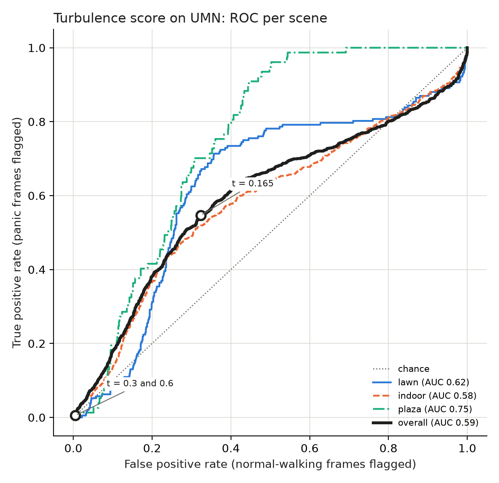
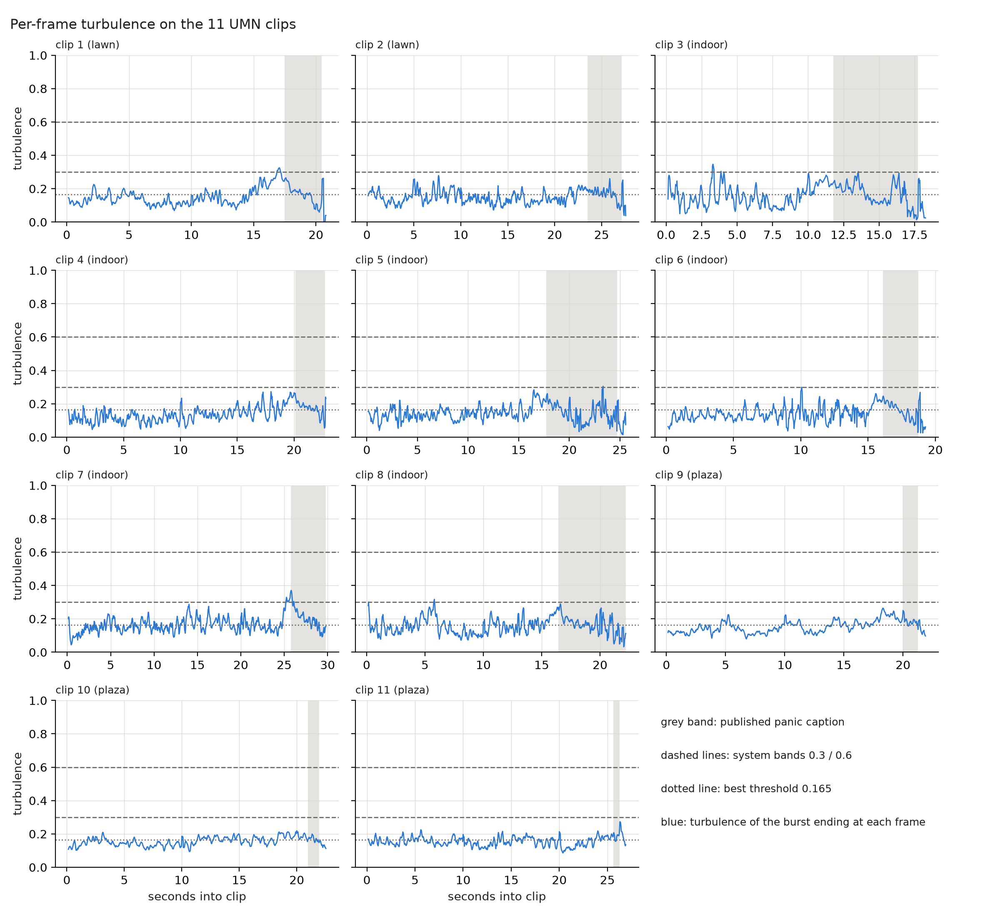

# Turbulence validation on UMN Unusual Crowd Activity (Phase 6B)

11 clips (2 lawn, 6 indoor, 3 plaza), 7695 frames scored at 30 fps, 320x240. Overall AUC **0.594** (normal walking vs panic, per frame); best threshold 0.165 (TPR 0.55, FPR 0.32). The live pipeline is unchanged.

## Comparison with the system's turbulence bands

- **Separation**: overall AUC 0.594 (a weak separator: well below the 0.8 usually asked of a detector); per scene lawn 0.62, indoor 0.58, plaza 0.75. Leaving out the second before each published onset changes it to 0.618.
- **The bands vs the data**: panic frames reach 0.3 in 0.01 of cases and 0.6 in 0.00; 0.3 catches 3 / 11 panics and 0.6 0 / 11. On UMN both bands sit above almost all of the signal, normal or panic.
- **The best threshold is not usable as an alarm**: 0.165 flags 0.32 of normal-walking frames, 77 false alarms per minute on the raw per-frame score; it catches every panic only because the score already hovers around it during normal walking.
- **Speed separates better than turbulence here**: mean moving speed AUC 0.712 overall (lawn 0.98, indoor 0.65, plaza 0.96). UMN's panic is people running away, each block moving one way: fast but locally orderly, which a direction-variance score is not built to see.

**Recommendation (not applied)**: Keep 0.3 / 0.6 as they are for now. Lowering the band to the UMN best threshold would mark a third of normal walking; raising it would never fire here. UMN does not test what the score is meant for (counter-flow, pushing and swirling in dense crowds), so it neither validates nor refutes the bands for Kumbh. It does show that turbulence alone does not detect a running crowd; a speed term (or a sudden-speed-rise alarm) looks more promising (speed AUCs above: high outdoors, low indoors) and should be evaluated before any change. Turbulence enters the live risk continuously (pressure = density x (1 + 0.5 x turbulence)), so the bands only change the dashboard's LOW / MEDIUM / HIGH label.

## At the best threshold and at the system's bands (overall)

| threshold | panic frames flagged (TPR) | normal frames flagged (FPR) | clips detected | median delay (s) | max delay (s) | false alarms / min of normal walking | with 1 s guard |
|---|---|---|---|---|---|---|---|
| 0.165 (best, Youden) | 0.55 | 0.32 | 11 / 11 | 0.00 | 0.03 | 77.4 | 80.7 |
| 0.3 (MEDIUM band) | 0.01 | 0.01 | 3 / 11 | 1.77 | 5.60 | 1.7 | 1.2 |
| 0.6 (HIGH band) | 0.00 | 0.00 | 0 / 11 | - | - | 0.0 | 0.0 |

TPR / FPR: share of panic / normal frames whose score reaches the threshold. A clip is detected when the score reaches the threshold between the published panic onset and the end of the caption; delay = seconds from the onset to that frame. False alarms: switch-ons of the alarm during normal walking, per minute.

## ROC per scene

| group | normal frames | panic frames | AUC | AUC, 1 s guard | best threshold | TPR / FPR at best | TPR / FPR at 0.3 | TPR / FPR at 0.6 | mean speed AUC (reference) |
|---|---|---|---|---|---|---|---|---|---|
| lawn | 1222 | 192 | 0.624 | 0.653 | 0.155 | 0.71 / 0.36 | 0.00 / 0.01 | 0.00 / 0.00 | 0.977 |
| indoor | 3213 | 822 | 0.581 | 0.608 | 0.166 | 0.51 / 0.31 | 0.01 / 0.01 | 0.00 / 0.00 | 0.647 |
| plaza | 1986 | 77 | 0.748 | 0.771 | 0.156 | 0.91 / 0.45 | 0.00 / 0.00 | 0.00 / 0.00 | 0.960 |
| overall | 6421 | 1091 | 0.594 | 0.618 | 0.165 | 0.55 / 0.32 | 0.01 / 0.01 | 0.00 / 0.00 | 0.712 |

AUC, 1 s guard: the same with the 1 s before each published onset left out. Mean speed AUC: the burst's mean moving speed scored the same way, as a reference for what the turbulence score adds or misses.

## Detection delay per clip

| clip | scene | panic from (s into clip) | delay s @ 0.165 | delay s @ 0.3 | delay s @ 0.6 |
|---|---|---|---|---|---|
| 1 | lawn | 17.5 | 0.00 (on before) | missed (on before) | missed |
| 2 | lawn | 23.5 | 0.00 (on before) | missed | missed |
| 3 | indoor | 11.8 | 0.00 (on before) | 1.77 | missed |
| 4 | indoor | 20.1 | 0.00 (on before) | missed | missed |
| 5 | indoor | 17.7 | 0.00 (on before) | 5.60 | missed |
| 6 | indoor | 16.1 | 0.00 (on before) | missed | missed |
| 7 | indoor | 25.8 | 0.00 (on before) | 0.00 (on before) | missed |
| 8 | indoor | 16.4 | 0.00 (on before) | missed | missed |
| 9 | plaza | 20.0 | 0.00 (on before) | missed | missed |
| 10 | plaza | 21.0 | 0.03 (on before) | missed | missed |
| 11 | plaza | 25.6 | 0.00 (on before) | missed | missed |

"(on before)": the alarm was already on during the 1 s before the published onset.

## False alarms per minute of normal walking

| group | normal minutes | FA/min @ 0.165 | FA/min @ 0.3 | FA/min @ 0.6 | FA/min @ 0.165, 1 s guard | FA/min @ 0.3, 1 s guard | FA/min @ 0.6, 1 s guard |
|---|---|---|---|---|---|---|---|
| lawn | 0.68 | 69.2 | 1.5 | 0.0 | 72.8 | 0.0 | 0.0 |
| indoor | 1.78 | 93.6 | 2.8 | 0.0 | 97.3 | 2.4 | 0.0 |
| plaza | 1.10 | 56.2 | 0.0 | 0.0 | 58.9 | 0.0 | 0.0 |
| overall | 3.57 | 77.4 | 1.7 | 0.0 | 80.7 | 1.2 | 0.0 |

## Per-frame turbulence per clip

## Ground truth

The UMN video carries its ground truth as a red "Abnormal Crowd Activity" caption that the authors burnt into the frames from the moment they mark the crowd as panicking. `scripts/umn_labels.py` reads it frame by frame (no judgement); clip boundaries are the hard cuts after each caption; scenes from the clips' colours.

| clip | scene | frames | panic_frame (caption on) | caption until |
|---|---|---|---|---|
| 1 | lawn | 0-624 | 525 | 614 |
| 2 | lawn | 625-1452 | 1330 | 1439 |
| 3 | indoor | 1453-2001 | 1806 | 1985 |
| 4 | indoor | 2002-2686 | 2605 | 2684 |
| 5 | indoor | 2687-3454 | 3219 | 3428 |
| 6 | indoor | 3455-4033 | 3938 | 4017 |
| 7 | indoor | 4034-4928 | 4807 | 4928 |
| 8 | indoor | 4929-5595 | 5422 | 5595 |
| 9 | plaza | 5596-6253 | 6196 | 6234 |
| 10 | plaza | 6254-6930 | 6883 | 6912 |
| 11 | plaza | 6931-7738 | 7700 | 7719 |

**Eye check, for you to confirm** (not used as ground truth): the caption appears after people start running in several clips, which is why the 1 s guard results are shown. people visibly running before the caption appears: clips 1, 2, 9, 10, 11; running blur probably before the caption: clips 3, 6, 7; no clear difference seen: clips 4, 5, 8. Frames to look at: `data/umn/checks/onsets_clips_*.jpg` (git-ignored).

## Method

- **Score**: `ml.optical_flow.burst_turbulence` (the production function) on the 5-frame burst ending at every frame; FlowParams(max_width=320, camera compensation on), default TurbulenceParams (block 32 px at 640 px, min speed 0.5 px/frame). The video is 320 px wide, so the 320 px downscale leaves it unchanged. Bursts flagged as moving camera: 0 of 7695.
- **Labels**: normal = the burst ends before the onset; panic = it starts at or after the onset and ends while the caption shows; bursts spanning the onset and frames after the caption are left out of the ROC.
- **Live sampling differs**: the live system scores one 5-frame burst every 2 s and smooths the risk over 30 s; this scores every frame, so delays and false-alarm counts are for the raw signal, before any smoothing.
- **How the score is used live**: risk pressure = density x (1 + k x turbulence) with k = PRESSURE_K (0.5); turbulence is not thresholded there. 0.3 and 0.6 are the LOW / MEDIUM / HIGH bands of `turbulence_to_label` (backend/ml/optical_flow.py, frontend/src/risk.js) shown on the dashboard.
